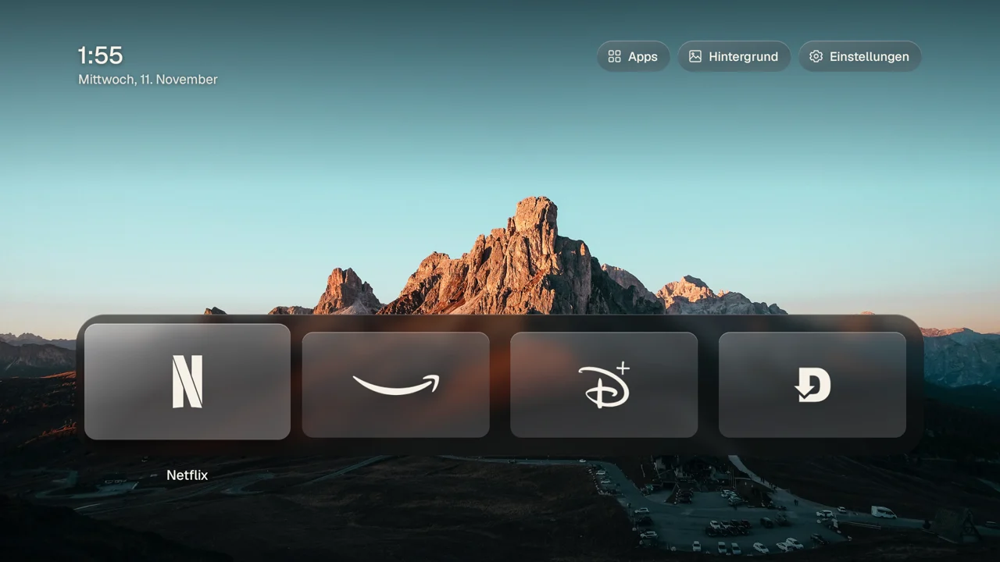
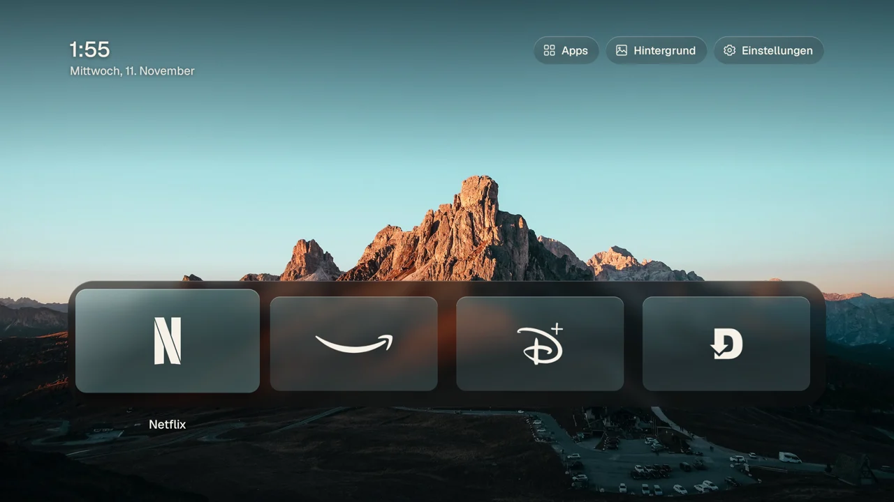
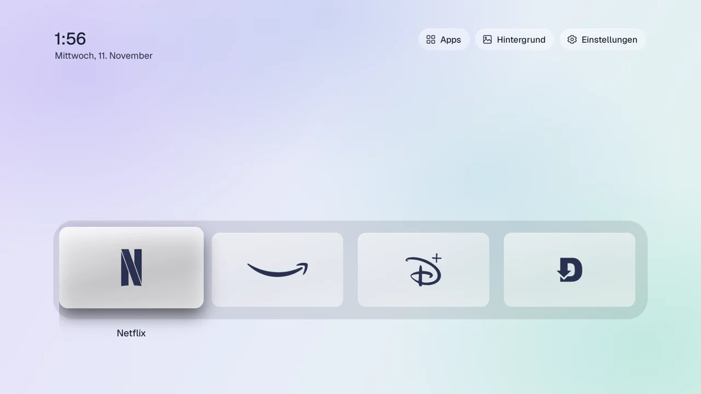
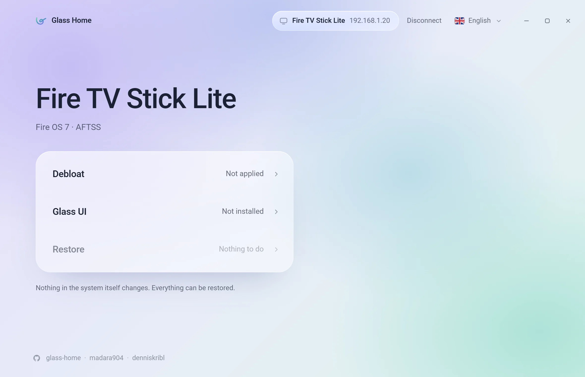

<h1 align="center">Glass Home</h1>

<p align="center">
  <b>A glass home screen for your Fire TV, set up from Windows or Mac.</b><br>
  Your colours, your own photos, a slideshow, and Amazon's ads turned off.<br>
  A small Tauri app that speaks adb itself. No root, no terminal, undo in one click.
</p>

<p align="center">
  <a href="https://github.com/madara904/glass-home/releases/latest"></a>
  <a href="https://github.com/madara904/glass-home/releases"></a>
  <a href="https://github.com/madara904/glass-home/actions/workflows/ci.yml"></a>
  <a href="LICENSE"></a>
</p>

<p align="center">
  
</p>

<table>
  <tr>
    <td width="33%"><br><sub><b>Auto</b>: the glass takes the photo's colour.</sub></td>
    <td width="33%"><br><sub><b>Lavender</b>: light glass on a soft colour field.</sub></td>
    <td width="33%"><br><sub>The desktop tool that sets it all up.</sub></td>
  </tr>
</table>

<p align="center">
  <a href="#download">Download</a> ·
  <a href="#quick-start">Quick start</a> ·
  <a href="https://madara904.github.io/glass-home/">Step-by-step guide</a> ·
  <a href="#what-it-does">What it does</a> ·
  <a href="#faq">FAQ</a> ·
  <a href="CONTRIBUTING.md">Contributing</a>
</p>

---

Glass Home is two things:

- **A desktop tool** for Windows and macOS. It finds your Fire TV on the network, turns off
  Amazon's ad, tracking and telemetry packages, and installs the new home screen over adb. It
  speaks adb itself, in Rust, so there is no adb or anything else to install.
- **A home screen** for the TV (`launcher/`), plain Java without libraries, package
  `app.glasshome.tv`.

Nothing on the TV's system partition changes. **Restore** turns everything back to how it was.

> **Yet another vibe-coded app.** Glass Home was built in conversation with an AI and tested on a
> real Fire TV Stick, one stubborn evening at a time. It is a starting point, not a finished
> product: read it, change it, make it yours.
>
> - The launcher is plain Java without libraries; almost all of it is one file you can read in an
>   evening, [`Stage.java`](launcher/src/app/glasshome/tv/Stage.java).
> - The desktop tool is a small Tauri app: Rust for the TV work ([`tool/src-tauri/src`](tool/src-tauri/src)),
>   TypeScript for the window ([`tool/src`](tool/src)).
> - Ideas waiting for someone: an ad-free screensaver with the slideshow, a quick menu on a long
>   press of Home, the remote's app buttons opening apps of your choice, a kids mode, Android TV
>   and Google TV support, the same tool on Android phones.
>
> Pull requests are welcome; so is a fork that goes its own way.

## Download

| System | File |
|---|---|
| Windows | [`Glass Home.exe`](https://github.com/madara904/glass-home/releases/latest) (runs without installing) |
| macOS (Apple Silicon and Intel) | [`Glass-Home-macOS.zip`](https://github.com/madara904/glass-home/releases/latest) |
| Android phone (Android 7 or newer) | [`Glass-Home-Android.apk`](https://github.com/madara904/glass-home/releases/latest): install it, allow installing from your browser when asked; the phone must be on the same Wi-Fi as the TV |

The programs are not signed yet, so the first start shows a warning:

- **Windows:** SmartScreen says "Windows protected your PC". Choose **More info › Run anyway**.
- **macOS:** unzip and open **Glass Home**. When macOS refuses, go to System Settings ›
  Privacy & Security and choose **Open Anyway** next to Glass Home. After that it opens
  normally.

## Quick start

1. **On the TV, turn on ADB debugging once.** Settings › My Fire TV › About, press OK on the
   device name seven times to become a developer. Then My Fire TV › Developer options ›
   ADB debugging: on.

2. **Open Glass Home on a computer in the same Wi-Fi.** It finds the Fire TV by itself. If it
   doesn't, type the TV's address (Settings › My Fire TV › About › Network).
3. **Confirm on the TV.** The first time, the TV asks "Allow USB debugging?". Tick "Always allow
   from this computer" and choose OK.

Then choose **Debloat**, wait for the TV's restart, and choose **Glass UI**. The
[step-by-step guide](https://madara904.github.io/glass-home/) walks through every screen with
pictures; it is also in [`docs/`](docs/index.html).


## What it does

| Action | On the TV |
|---|---|
| Debloat | disables Amazon's ad, tracking and telemetry packages, sets the privacy settings, limits the packages Amazon protects, optional DNS filter (personalDNSfilter, checksum-pinned) |
| Glass UI | installs the launcher and gives it the HOME button (accessibility guard on Fire OS 7/8, keeper on Fire OS 6), carries over the settings of an earlier install |
| Colours and photos | five colour schemes (Neutral, Auto from the wallpaper, Mint, Sand, Lavender), your own photo as the background, a slideshow with interval and order; set in the tool or on the TV |
| Restore | turns everything back on, puts back the settings saved before the first debloat, removes the DNS filter and Glass Home, hands HOME back to Amazon |
| Turn off ADB | when you are done: switches ADB debugging off on the TV, so nobody on your network can control it; Glass Home keeps working |

## Supported devices

| Fire OS | Status |
|---|---|
| Fire OS 8 | supported (the DNS filter is not built yet) |
| Fire OS 7 | supported |
| Fire OS 6 | supported |
| Fire OS 5 and older | not supported: packages can't be turned off |
| Vega OS | not supported: no sideloading, no adb |

Google TV and Android TV devices show up greyed out in the search: Glass Home is built for
Fire OS only.

## Privacy

- **The tool talks to** your Fire TV over the local network. It finds it through mDNS, the
  router's host names, the ARP table and a scan of adb's port on your subnet.
- **When you choose the DNS filter,** it downloads personalDNSfilter from F-Droid (checked
  against a pinned checksum), its default configuration from GitHub (pinned the same way), and
  the hagezi blocklist from jsDelivr.
- **Nothing else.** No telemetry, no accounts, no analytics. Settings saved before Debloat stay
  on your computer, in the app's data folder.

## FAQ

**The TV never asks "Allow USB debugging?"**
The dialog appears on the TV screen. Make sure the TV is on and shows the Fire TV's picture,
then connect again from Glass Home.

**The search finds nothing.**
Check that ADB debugging is on and that the computer and the TV are in the same network (not a
guest network). On Windows, allow Glass Home through the firewall when asked; the search needs
it. You can always type the TV's address instead.

**Fire OS refused the home screen takeover.**
Parental controls can block it. Turn them off, run Glass UI, then turn them back on.

**How do I undo everything?**
Connect and choose **Restore**. It brings back Amazon's home screen, turns the packages back on,
resets the settings saved before the first debloat and removes the DNS filter and Glass Home.

## Build from source

The desktop tool needs Rust, Node 22 and pnpm. The launcher APK it bundles is in the repository, so no Android SDK is needed for the tool alone.

```sh
cd tool && pnpm install && pnpm tauri build        # the app for this computer
pnpm tauri dev                                     # with live reload
```

The launcher needs JDK 17 and the Android SDK (a platform and build-tools):

```sh
cd launcher && ./build.sh                          # launcher/build/glass-home.apk
cp launcher/build/glass-home.apk tool/src-tauri/resources/
```

`launcher/release.keystore` signs the launcher and is not in the repository. Keep it: updates
must carry the same signature.

A debug build (`tool/src-tauri/target/debug/glass-home-tool`, from `pnpm tauri dev`) also runs
from the command line, which helps when checking a TV:

```sh
glass-home-tool --discover                    # the network search, as JSON
glass-home-tool --probe <tv-ip>               # device, state and apps; changes nothing
glass-home-tool --run ui|debloat|restore <tv-ip>
```

More in [CONTRIBUTING.md](CONTRIBUTING.md).

## Credits

- [dumbtv](https://github.com/humblemuzzu/dumbtv) (MIT) for the Fire OS knowledge, the package
  lists and the HOME takeover.
- [CleanFrame](https://github.com/nthnclrk/CleanFrame) (MIT) for the look.
- [personalDNSfilter](https://github.com/IngoZenz/personaldnsfilter) and the
  [hagezi blocklists](https://github.com/hagezi/dns-blocklists) for the DNS filter.

Everything else is listed in [THIRD_PARTY.md](THIRD_PARTY.md) and `launcher/NOTICE.md`.

## License

The Glass Home code is [MIT](LICENSE). The photographs, fonts and service marks in
`launcher/assets` and the bundled tools keep their own licenses; see
[THIRD_PARTY.md](THIRD_PARTY.md).

## Disclaimer

Glass Home is not affiliated with or endorsed by Amazon. Amazon, Fire TV and Fire OS are
trademarks of Amazon.com, Inc. or its affiliates. Glass Home changes settings and packages on
your TV over adb; use it at your own risk. Restore undoes its changes.
