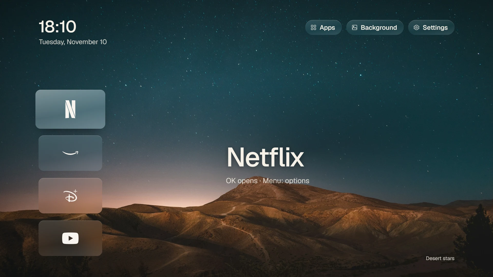
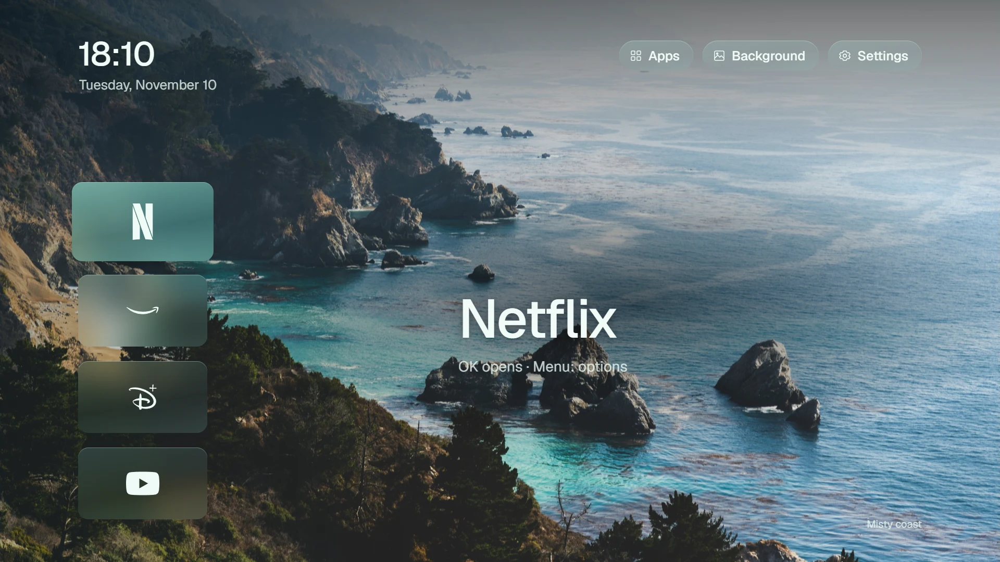
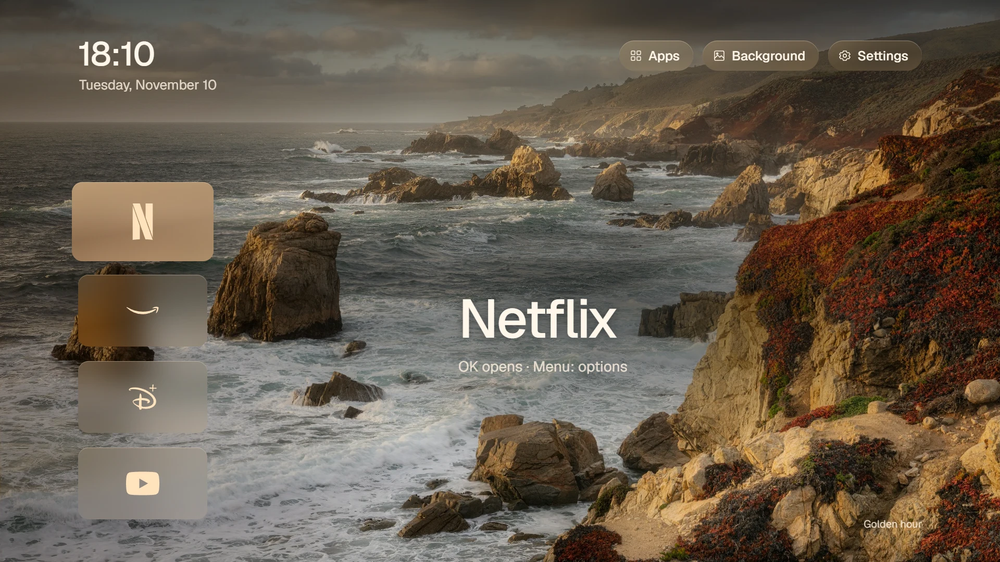
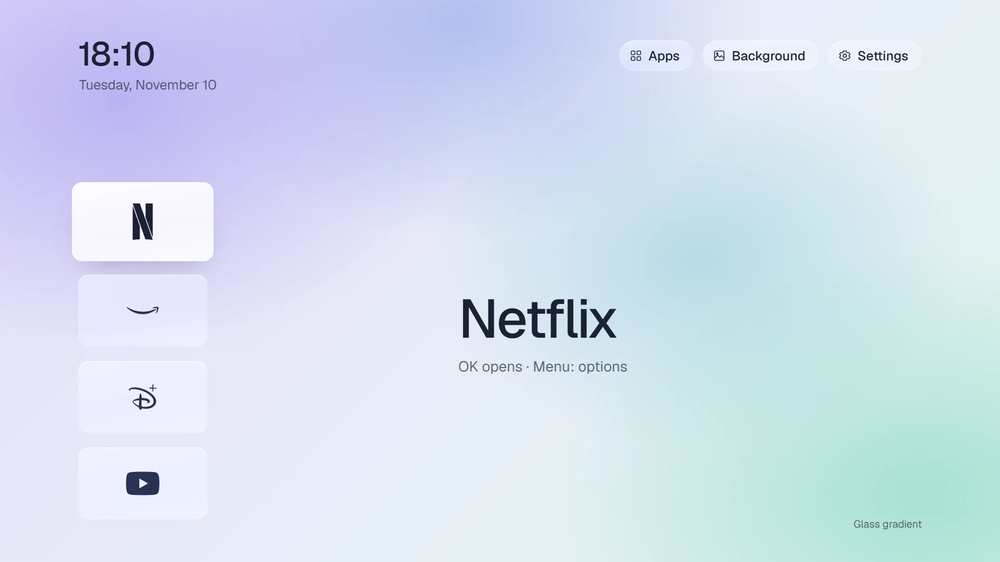

# Colour themes: previews

Drafts for colour options on the TV home screen (Icons layout), rendered at 1920×1080 from the
launcher's own wallpapers, font (Geist) and marks. Nothing here is built into the launcher yet.

| | Theme | Idea |
|---|---|---|
|  | **Neutral** | today's look: clear glass, white focus |
|  | **Mint** | accent taken from the wallpaper, cool-tinted glass |
|  | **Sand** | warm-tinted glass, icons in the accent |
|  | **Lavender** | a colour gradient instead of a photo, light glass, dark text |

All photo themes keep the launcher's legibility: the shade along the top (stronger on light
photos) and the soft dark field behind the app name.

`render.mjs` draws them (needs `puppeteer-core` and Microsoft Edge):
`node render.mjs ../../launcher <out dir>`.
